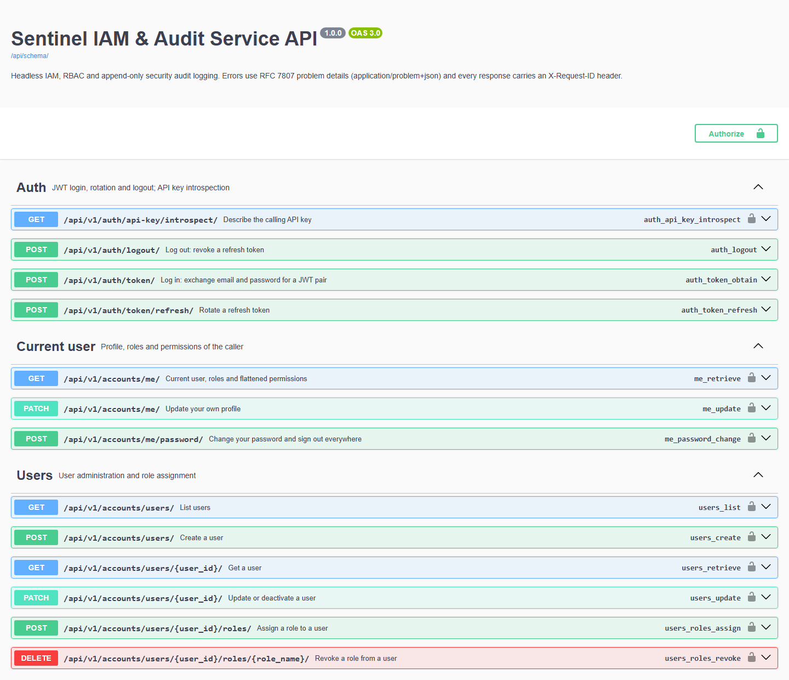
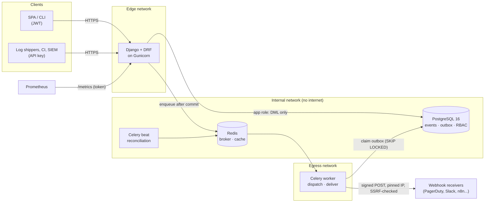
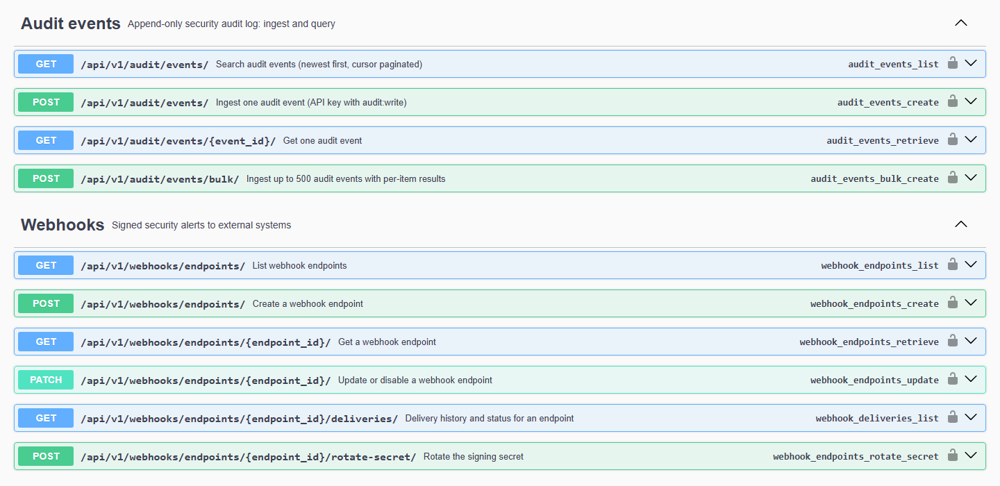

# Sentinel IAM & Audit Service

[](https://github.com/ali-fakhrabadi/sentinel-iam-audit-service/actions/workflows/ci.yml)


[](LICENSE)

Headless Identity and Access Management (IAM), Role-Based Access Control (RBAC) and
append-only security audit logging, with HMAC-signed webhooks for security alerts. Built
API-first for React / Next.js / TypeScript SPAs and machine-to-machine clients (log
shippers, CI pipelines, SIEM connectors).



## Highlights

- **Two credential types that never unlock each other's endpoints:** JWT for people,
  scoped, expiring, SHA-256-hashed API keys for service accounts.
- **RBAC without privilege escalation:** you can only grant what you hold, you cannot change
  your own roles, and only superusers manage superusers.
- **Append-only audit log enforced by PostgreSQL**, not just by the API: a trigger blocks
  `UPDATE`/`DELETE`/`TRUNCATE` for every role and the runtime role has no such privileges.
- **Bulk ingestion with per-item results** and race-free idempotency keys, plus keyset
  pagination whose queries stay in the low milliseconds on 2.7 million rows, including the
  skewed-data cases that made PostgreSQL's default plans take seconds.
- **Webhooks that are safe to point at the internet:** transactional outbox, HMAC-SHA256
  signatures with secret rotation, SSRF protection with DNS pinning, retries with backoff.
- **Production packaging:** hash-locked dependencies, non-root read-only containers,
  segmented networks, a Helm chart tested on kind in CI, Prometheus metrics, JSON logs.
- **Measured, not claimed:** [k6 benchmarks and query plans](docs/performance.md) with the
  scripts to reproduce them.

## Architecture



| Trust boundary | Controls |
|---|---|
| Internet → API | Strict input serializers that reject unknown fields, request size limit, per-scope rate limits, RFC 7807 errors without internals |
| Authenticated → authorized | Permission codes per HTTP method, deny by default; API keys carry scopes; escalation guard in the service layer |
| Application → PostgreSQL | Runtime role `sentinel_app` has no DDL and no `UPDATE`/`DELETE` on audit events; 5 s statement timeout |
| Worker → receivers | Every resolved address must be public; connection pinned to it; no redirects; timeouts; signed payloads |
| Network | PostgreSQL and Redis unreachable from outside; only the worker may egress (Kubernetes: only to public ranges) |

Design decisions and their trade-offs are in [docs/architecture.md](docs/architecture.md).

## Quick start

Requirements: Docker with Compose v2, GNU make, Python 3 (only to generate `.env`).

```bash
git clone https://github.com/ali-fakhrabadi/sentinel-iam-audit-service.git
cd sentinel-iam-audit-service
make env          # .env with generated secrets
make up           # build, migrate, start; waits for health checks
make superuser    # first administrator
```

The API listens on `http://127.0.0.1:8000`; Swagger UI is at
[`/api/docs/`](http://127.0.0.1:8000/api/docs/) and ReDoc at `/api/redoc/`. To expose it on
your LAN instead:

```bash
make env ENV_ARGS="--set SENTINEL_BIND_ADDRESS=0.0.0.0 --set DJANGO_ALLOWED_HOSTS=192.0.2.10,localhost,127.0.0.1"
```

## API walkthrough

The examples use `curl` and `jq` against a local stack.

```bash
API=http://127.0.0.1:8000/api/v1
```

**1. Log in and bootstrap the SPA.** `/me/` returns what a frontend needs to render
role-based UI: profile, role names and the sorted permission codes.

```bash
TOKENS=$(curl -s -X POST "$API/auth/token/" -H 'Content-Type: application/json' \
  -d '{"email": "admin@example.com", "password": "<password>"}')
ACCESS=$(echo "$TOKENS" | jq -r .access)

curl -s "$API/accounts/me/" -H "Authorization: Bearer $ACCESS" | jq
```

Access tokens live 15 minutes. `POST /auth/token/refresh/` rotates the refresh token (each
refresh token works once) and `POST /auth/logout/` blacklists it.

**2. Create a service account and an API key** for a machine producer. The raw key is
returned once, with `Cache-Control: no-store`; only its SHA-256 digest is stored.

```bash
SA=$(curl -s -X POST "$API/accounts/service-accounts/" -H "Authorization: Bearer $ACCESS" \
  -H 'Content-Type: application/json' -d '{"name": "edr-connector", "description": "EDR alerts"}' | jq -r .id)

KEY=$(curl -s -X POST "$API/accounts/service-accounts/$SA/api-keys/" -H "Authorization: Bearer $ACCESS" \
  -H 'Content-Type: application/json' -d '{"name": "prod", "scopes": ["audit:write", "audit:read"]}' | jq -r .key)

curl -s "$API/auth/api-key/introspect/" -H "X-API-Key: $KEY" | jq   # scopes and expiry
```

**3. Subscribe a webhook** to critical IAM events. The signing secret is shown once.

```bash
curl -s -X POST "$API/webhooks/endpoints/" -H "Authorization: Bearer $ACCESS" \
  -H 'Content-Type: application/json' \
  -d '{"name": "pager", "url": "https://hooks.example.com/sentinel", "min_severity": "CRITICAL", "action_prefixes": ["iam"]}' | jq
```

**4. Ingest events in bulk.** Each item is validated on its own; all valid items are stored
in one transaction. Re-sending the request is safe thanks to the idempotency keys.

```bash
curl -s -X POST "$API/audit/events/bulk/" -H "X-API-Key: $KEY" -H 'Content-Type: application/json' -d '{
  "events": [
    {"action": "iam.role.assigned", "resource_type": "iam.user", "resource_id": "u-42",
     "actor_id": "u-7", "severity": "CRITICAL", "metadata": {"role": "admin"},
     "idempotency_key": "edr-2026-10-26-0001"},
    {"action": "auth.login.failed", "resource_type": "auth.session", "severity": "BOGUS"}
  ]}' | jq
```

```json
{
  "accepted": 1,
  "duplicates": 0,
  "rejected": 1,
  "results": [
    { "index": 0, "status": "accepted", "event_id": "8c0f5f0e-..." },
    { "index": 1, "status": "rejected", "event_id": null,
      "errors": [{ "field": "severity", "message": "\"BOGUS\" is not a valid choice.", "code": "invalid_choice" }] }
  ]
}
```

**5. Query with a keyset cursor.** Filters: `actor_id`, `action`, `action_prefix`,
`resource_type`, `resource_id`, `severity` (repeatable), `ip_address`, `created_after`,
`created_before`, `metadata_contains` (JSON). Follow `next` until it is `null`.

```bash
curl -s "$API/audit/events/?action_prefix=iam&severity=CRITICAL&page_size=50" \
  -H "Authorization: Bearer $ACCESS" | jq '{count: (.results | length), next_cursor}'

curl -s "$API/audit/events/?action_prefix=iam&severity=CRITICAL&page_size=50&cursor=<next_cursor>" \
  -H "Authorization: Bearer $ACCESS" | jq
```

### TypeScript client types

The schema is OpenAPI 3 with separate request and response components, so generators
produce precise types:

```bash
npx openapi-typescript http://127.0.0.1:8000/api/schema/ -o src/api/sentinel.d.ts
```

```ts
import type { components } from "./api/sentinel";

type Me = components["schemas"]["Me"];
type AuditEvent = components["schemas"]["AuditEvent"];
```

## Authentication and authorization

| Caller | Credential | Used on |
|---|---|---|
| People (SPA, CLI) | `Authorization: Bearer <access JWT>` | Account, RBAC, query and webhook management endpoints |
| Machines | `X-API-Key: sntl_<prefix>_<secret>` | Ingestion, querying their own events, key introspection |

* **Users** receive permission codes (`resource:action`) through roles. Built-in roles:
  `admin`, `iam_manager`, `security_analyst`, `auditor`; custom roles can be added.
* **API keys** carry explicit scopes and a mandatory expiry (90 days by default, 365 at most).
  Lookup is by a non-secret prefix, verification in constant time, and every failure returns
  the same message.
* **Token lifecycle:** 15-minute access tokens, rotating single-use refresh tokens, logout
  blacklisting, and revocation of all tokens on password change or deactivation.
* Passwords are hashed with Argon2id; login and password endpoints are rate limited.

## Audit events



* Single (`POST /audit/events/`) and bulk (`POST /audit/events/bulk/`, up to 500) ingestion.
  A `503` means nothing was stored, so retrying the whole request is always safe.
* An `idempotency_key` already used by the same producer returns `duplicate` with the original
  event ID (first write wins), enforced by a unique index, so concurrent retries cannot race.
* The producer is taken from the credential, never from the body. `actor_id`, `ip_address`,
  `user_agent` and `occurred_at` are the producer's claims; `occurred_at` may be at most
  5 minutes ahead and 30 days old.
* Queries default to the last 30 days and are capped at 90; API keys see only their own events.
* **Append-only in three layers:** no mutation API, a trigger that rejects changes for every
  role, and revoked privileges for the runtime role. Retention is a separate command run as
  the schema owner: `python manage.py purge_audit_events --older-than-days 365`.
* Sentinel audits itself: role grants, key issuance and revocation, deactivation, password
  changes and webhook changes are recorded in the same transaction as the change.

## Webhooks

Events at or above `WARN` are written to a transactional outbox together with the event. A
Celery task drains it right after commit (coalesced to at most two drains per second), and a
beat task replays anything missed. Endpoints subscribe by minimum severity and optional action
prefixes.

```
POST <your endpoint>
X-Sentinel-Event-Id:  6f1c2c1e-...        # de-duplication key (delivery is at-least-once)
X-Sentinel-Timestamp: 1790000000
X-Sentinel-Signature: t=1790000000,v1=<hex>[,v1=<hex during secret rotation>]
```

The signature is `HMAC_SHA256(secret, f"{timestamp}.{event_id}." + raw_body)`. Verify it on
the receiver like this:

```python
import hashlib, hmac, time


def verify(secret: str, header: str, event_id: str, body: bytes, tolerance: int = 300) -> bool:
    timestamp, candidates = None, []
    for item in header.split(","):
        key, _, value = item.strip().partition("=")
        if key == "t" and value.isdigit():
            timestamp = int(value)
        elif key == "v1":
            candidates.append(value)
    if timestamp is None or abs(time.time() - timestamp) > tolerance:  # stale or replayed
        return False
    message = f"{timestamp}.{event_id}.".encode() + body
    expected = hmac.new(secret.encode(), message, hashlib.sha256).hexdigest()
    return any(hmac.compare_digest(expected, candidate) for candidate in candidates)
```

* **Retries:** exponential backoff with jitter (30 s base, 30 min cap) for timeouts, connection
  errors, `408`, `425`, `429` and `5xx`; other `4xx` and redirects fail permanently. The default
  of 5 retries means at most 6 attempts. Delivery history is available per endpoint.
* **Secrets:** stored encrypted with Fernet (key rotation supported); after an endpoint secret
  rotation both secrets sign for 24 hours.
* **SSRF protection:** destinations must be `https` without credentials, and every resolved
  address must be public (loopback, RFC 1918, CGNAT, link-local including `169.254.169.254`,
  multicast and reserved ranges are rejected, also as IPv4-mapped IPv6). The client connects
  to the validated address with SNI set to the host name, so DNS rebinding cannot redirect it.

## Performance

Measured with k6 against the default Docker Compose deployment (web 2 vCPU, PostgreSQL 2 vCPU,
worker 1 vCPU) on a 2.7-million-event dataset:

| Measurement | Result |
|---|---|
| Page queries in PostgreSQL, every filter including worst cases | 0.4 to 13 ms, no sequential scans |
| Single-event ingestion at 50 req/s | p50 19.6 ms, p95 33.5 ms, 0 errors |
| Bulk ingestion, 10 clients x 100 events | 1,760 events/s, p95 917 ms, 0 errors |
| Audit queries, mixed filters at 25 req/s | p50 16 to 64 ms, p95 57 to 139 ms, 0 errors |
| Event to acknowledged signed webhook | p50 881 ms, p95 1,582 ms, 1,200 of 1,200 delivered |
| Overload: 200 req/s scheduled | 148.8 req/s completed, 0 errors, latency grows instead |

The web tier's CPU is the limit, and CPU-bound results varied by up to about 20 % between
runs. The benchmarks also found and fixed real problems: a webhook dispatch flood, query plans
that took seconds on unevenly distributed data, and dropped keep-alive connections. Full
results, query plans, methodology and limitations: [docs/performance.md](docs/performance.md).

## Deployment

### Docker Compose

`make up` runs Gunicorn, a Celery worker, Celery beat, PostgreSQL 16 and Redis with:
non-root UID 10001, read-only root filesystems, all capabilities dropped, resource limits,
health checks, and three networks (edge, internal backend, worker egress). Migrations run as
the schema owner in a one-shot container before the application starts.

### Kubernetes (Helm)

```bash
helm install sentinel charts/sentinel \
  --set config.allowedHosts=sentinel.example.com \
  --set database.host=postgres.example.internal --set redis.host=redis.example.internal \
  --set secrets.existingSecret=sentinel-secrets
```

The chart includes web, worker and beat Deployments, a migration hook Job (schema-owner
credentials, runs before upgrades), PodDisruptionBudget, optional HPA and Ingress, restricted
pod security contexts, and NetworkPolicies that allow the worker to reach only public
addresses. CI installs it on a [kind](https://kind.sigs.k8s.io/) cluster, runs `helm test` and
checks the database role separation on every push. Day-2 operations (secret rotation,
backups, retention, alerts) are in [docs/operations.md](docs/operations.md).

## Configuration

All settings come from environment variables; [.env.example](.env.example) documents them.
The most important ones:

| Variable | Default | Purpose |
|---|---|---|
| `DJANGO_SECRET_KEY`, `JWT_SIGNING_KEY` | none (required) | Django signing and JWT HMAC keys |
| `DJANGO_ALLOWED_HOSTS` | `localhost,127.0.0.1` | Host header allow-list |
| `DJANGO_SECURE_HTTPS` | `true` | Secure cookies, HSTS and HTTPS redirect; `.env.example` sets `false` for local HTTP |
| `CORS_ALLOWED_ORIGINS` | `http://localhost:3000,http://localhost:5173` | SPA origins allowed to call the API |
| `DB_USER` | `sentinel_app` | Runtime database role (migrations use the schema owner) |
| `DB_STATEMENT_TIMEOUT_MS` | `5000` | Upper bound for any runtime query |
| `JWT_ACCESS_TOKEN_LIFETIME_MINUTES` | `15` | Access token lifetime |
| `THROTTLE_RATE_AUTH` / `THROTTLE_RATE_INGEST` | `10/minute` / `1200/minute` | Login and ingestion rate limits |
| `AUDIT_BULK_MAX_EVENTS` | `500` | Events per bulk request |
| `AUDIT_OUTBOX_MIN_SEVERITY` | `WARN` | Lowest severity that can trigger webhooks |
| `WEBHOOK_SECRET_ENCRYPTION_KEYS` | none (required) | Comma-separated Fernet keys; the first encrypts |
| `WEBHOOK_MAX_RETRIES` | `5` | Retries after the first attempt |
| `METRICS_AUTH_TOKEN` | none (required) | Bearer token for `/metrics` |

## Operational endpoints

| Endpoint | Purpose | Access |
|---|---|---|
| `GET /health/live/` | Liveness: the process serves requests (no dependency checks) | Public |
| `GET /health/ready/` | Readiness: PostgreSQL and Redis reachable within bounded timeouts | Public |
| `GET /metrics` | Prometheus metrics aggregated across Gunicorn workers, plus outbox and delivery gauges | `Authorization: Bearer $METRICS_AUTH_TOKEN` |
| `GET /api/schema/`, `/api/docs/`, `/api/redoc/` | OpenAPI 3 schema, Swagger UI, ReDoc (self-hosted assets) | Public |

Every error is an RFC 7807 `application/problem+json` document with a `request_id`. Every
response carries `X-Request-ID`, and the same ID appears in the JSON logs, where passwords,
tokens, API keys and webhook secrets are redacted.

## Development

| Command | Purpose |
|---|---|
| `make test` | pytest with coverage (at least 95 %) against real PostgreSQL and Redis containers |
| `make lint` / `make format` | Ruff lint and format |
| `make typecheck` | mypy with the Django and DRF plugins, all definitions typed |
| `make check` | Django system checks and migration drift detection |
| `make schema` | Validate and export the OpenAPI schema |
| `make audit` | pip-audit on the locked runtime dependencies |
| `make ci` | Everything CI runs |
| `make lock` | Re-resolve and hash-pin dependencies for Python 3.12 / Linux |

CI (GitHub Actions, actions pinned to commit SHAs) runs lint, types, checks, schema
validation, the test suite, pip-audit, a Trivy image scan, the Helm/kind deployment test and
publishes the image to GHCR from `main`.

## Security notes and limitations

* Append-only is enforced by the database, but this is not cryptographic tamper evidence: a
  PostgreSQL superuser can disable triggers. Ship events to WORM storage if you need that.
* Webhook delivery is at-least-once; receivers must de-duplicate on `X-Sentinel-Event-Id`.
* `actor_id`, `ip_address` and `occurred_at` in ingested events are the producer's claims.
* Two searches can still take seconds on large tables: an action prefix that is rare among
  recent events, and a metadata value that is frequent only in older events
  ([measured](docs/performance.md#limitations)). The 5-second statement timeout bounds them, and
  a timeout returns `503`.
* The audit table is not partitioned yet; [docs/operations.md](docs/operations.md) explains
  when partitioning by month becomes worthwhile.
* Rate limits use the Redis cache; behind a proxy set `API_TRUSTED_PROXY_COUNT` correctly, or
  clients can spoof their address.

## License

[MIT](LICENSE)
